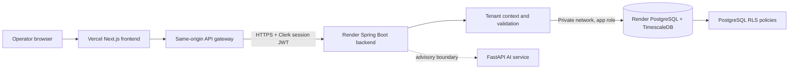

# Architecture

## System purpose

Canopy Operations Cloud provides a tenant-isolated operating system for commercial nursery workflows. The design separates the browser experience, business API, database enforcement layer, and advisory AI boundary so that operational decisions remain traceable and tenant ownership is enforced at more than one layer.

The cloud topology is Vercel for the frontend, Render for the backend and database, and Clerk Organizations for identity. The frontend's server-side `/api/*` gateway forwards a verified Clerk session token to the public HTTPS backend; the browser does not call the backend directly. Render's private network connects the backend to PostgreSQL. The optional self-hosted production profile instead places Caddy in front of the Next.js server and keeps the other services on a private Compose network.

The browser communicates with the frontend at the same origin. The frontend owns the `/api/*` gateway route, which forwards authenticated requests to the backend and turns connection failures into a controlled `503` response. This avoids browser-level exposure of backend topology and prevents raw proxy connection errors from becoming user-facing runtime failures.

## Runtime components

| Component | Primary responsibility | Public exposure | State |
|---|---|---|---|
| Next.js frontend | CRM workflows, presentation, API gateway, controlled data states | Public through Vercel or Caddy | Stateless except browser cache |
| Spring Boot backend | Domain validation, tenant context, REST endpoints, JWT validation | Private Render network or Compose network | Stateless application service |
| PostgreSQL/TimescaleDB | Operational records, RLS policies, append-only events, sensor-ready storage | Private Render network or Compose network | Persistent volume |
| FastAPI AI service | Advisory diagnostic boundary only; no live inference workflow is connected | Local Compose only; excluded from cloud deployment | Stub service boundary |
| Caddy | TLS certificates, HTTPS entry point, reverse proxy | Public ports 80 and 443 | Certificate/config volumes |

## Request and tenant flow

A cloud request begins at Vercel and reaches the Next.js frontend. Its server-side API gateway sends the request to the Render backend over HTTPS with the Clerk bearer token. The backend validates the token signature, issuer, expiry, and audience, constructs a trusted `TenantPrincipal`, and populates `TenantContext` only from verified claims. In the self-hosted profile, Caddy forwards requests to the frontend and the gateway reaches the backend over the private Compose network. `TenantFilter` rejects a caller-supplied tenant header that conflicts with the verified token, rather than allowing the header to select a tenant.

`TenantAwareExecutor` runs tenant-scoped work inside a transaction. For PostgreSQL application runs, it sets `app.tenant_id` with transaction-local scope. PostgreSQL row-level policies use this context to scope reads and writes. Entity callbacks also assign tenant ownership from the trusted context before persistence, so client payloads do not own `tenant_id`.

| Protection layer | Control | Failure behavior |
|---|---|---|
| Token validation | Signed JWT is required for protected API routes | Unauthorized request is rejected. |
| Tenant selection | Tenant is derived from verified claims | Conflicting caller header is rejected. |
| Application transaction | Tenant context is mandatory for scoped work | Missing context raises an exception. |
| Persistence | Entity listener assigns trusted tenant ownership | Caller cannot select a tenant through JSON fields. |
| Database | RLS policies and forced RLS restrict table access | Cross-tenant data is blocked by PostgreSQL policy. |

## Domain boundaries

The backend is organized by operational feature. Each package owns its entity, repository, service, and controller, while cross-cutting tenant and security logic remains separate.

| Domain package | Responsibility |
|---|---|
| `plantbatch` | Living crop inventory, lifecycle, quantities, cost, and zone association. |
| `batchevent` | Append-only field events such as moves, mortality, treatment logging, and lifecycle changes. |
| `treatment` | Crop applications, withholding periods, and safe-ship calculations. |
| `diagnostic` | Plant-health observations and review-required advisory output. |
| `order` | Customer commitments and order line items. |
| `greenhouse` | Physical growing zones and microclimate targets. |
| `tenant` | Request context, transaction-scoped SQL context, and tenant ownership. |
| `security` | JWT verification, authenticated principal creation, and route protection. |

## Data lifecycle decisions

Plant batches are current-state records. Their history is captured through `batch_events`, which are database-protected from updates and deletion. This distinction keeps the current crop view efficient while preserving the operational facts needed for audit and future offline synchronization.

Treatments calculate a `safe_ship_date` from the applied date and withholding period. The current system records and surfaces the control; production policy must continue to require a verified, authoritative product-label source before any automated dispatch decision is considered final.

Diagnostic output is advisory. Records are created with human review in mind, and no diagnostic model is allowed to autonomously approve crop actions or compliance decisions.

## Deployment profiles

| Profile | Compose file | Intended use | Authentication behavior |
|---|---|---|---|
| Local development | `docker-compose.yml` | Developer workstation and seeded demo workspace | Restricted local demo session enabled. |
| Production | `docker-compose.prod.yml` | Public deployment behind Caddy | Demo session disabled; verified identity-provider integration required. |

The production profile distinguishes the database owner from the backend application role. The owner initializes schema and grants access. The backend runs with the non-owner application role so it does not inherit table-owner privileges that can bypass RLS.

## Architectural constraints and planned boundaries

The application is intentionally not yet a full offline-write platform, a sensor ingestion system, or a trained diagnostic product. IndexedDB currently supports read caching and a field-event queue foundation; conflict resolution and reliable write synchronization remain planned work. Likewise, PostgreSQL RLS is the production enforcement mechanism; H2 unit tests verify application ownership behavior but cannot prove PostgreSQL policy enforcement.

See [DATA_MODEL.md](DATA_MODEL.md) for core records, [SECURITY.md](SECURITY.md) for controls and identity boundaries, and [DEPLOYMENT.md](DEPLOYMENT.md) for operational deployment details.
