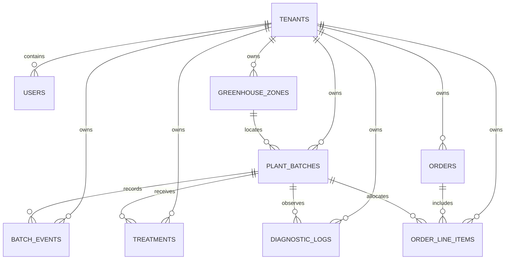

# Data Model

## Model overview

Canopy models a nursery as a tenant-owned operational graph. Every business record is scoped to a tenant, while crop batches form the central living inventory record linked to locations, events, treatments, diagnostics, and commercial commitments.

## Core entities

| Entity | Purpose | Important relationships |
|---|---|---|
| `tenants` | Workspace and data-isolation boundary. | Parent of all tenant-owned business records. |
| `users` | Authenticated operator identity. | Belongs to one tenant; may review diagnostic records or record events. |
| `greenhouse_zones` | Physical growing locations and JSON-backed microclimate targets. | A zone can contain many plant batches. |
| `plant_batches` | Current-state living inventory record. | Central entity for crop events, treatments, diagnostics, and order allocations. |
| `batch_events` | Immutable history of operational events. | Belongs to a tenant and crop batch; recorded by a verified user. |
| `treatments` | Applied product and withholding record. | Belongs to one tenant and crop batch. |
| `diagnostic_logs` | Plant-health observation and advisory review record. | Belongs to one tenant and crop batch. |
| `orders` | Customer commitment record. | Owns one or more order line items. |
| `order_line_items` | Species and quantity commitment, optionally allocated to a crop batch. | Belongs to an order and tenant; may reference a crop batch. |
| `sensor_readings` | Time-series foundation for future environmental telemetry. | Tenant-owned, intended for TimescaleDB hypertable usage. |

`greenhouse_zones.microclimate` and `batch_events.payload` are JSONB values. Their API/entity types preserve structured JSON; omitted values are stored as empty JSON objects rather than SQL `NULL`.

## Tenant ownership

Tenant-owned tables carry `tenant_id`. The application does not accept this field as a source of ownership from user payloads. A persistence listener assigns ownership from `TenantContext`, and PostgreSQL row-level security uses the transaction-local `app.tenant_id` setting to constrain rows.

| Table category | Ownership rule |
|---|---|
| Tenant root | `tenants` defines the workspace boundary. |
| Operator records | `users` belongs to exactly one tenant. |
| Operational records | Zones, batches, events, treatments, diagnostics, orders, and line items all carry tenant ownership. |
| Cross-record links | Services validate that a referenced batch, zone, order, or line item is visible in the same tenant before saving. |

## Plant batch lifecycle

A plant batch represents the current state of a crop cohort. The intended lifecycle is `propagating → growing → mature → sold` with `dead` as a terminal loss state. Current quantities represent the present stock position, while events preserve material history.

| Field | Role | Validation or behavior |
|---|---|---|
| `species` | Commercial crop name | Required by creation workflow. |
| `zone_id` | Current growing location | Optional; when set, must belong to the same workspace. |
| `propagation_date` | Lifecycle starting point | Required by crop-batch creation. |
| `quantity_initial` | Original cohort size | Database field is required; service protects non-negative state. |
| `quantity_current` | Current available plants | Must be zero or greater and not exceed initial quantity. |
| `unit_cost` | Per-plant cost basis | Must be zero or greater. |
| `status` | Lifecycle state | Database constraint allows `propagating`, `growing`, `mature`, `sold`, or `dead`; default is `propagating`. |

The model deliberately separates current state from event history. A current batch may be updated as a business record, but `batch_events` preserve operational facts such as mortality, movement, stage change, and treatment activity.

## Batch events and auditability

`batch_events` are append-only. The database security script creates triggers that reject `UPDATE` and `DELETE` operations. Event records contain a batch reference, an event type, JSONB payload, occurrence time, server receipt time (`synced_at`), tenant ownership, and the server-derived recorder identity.

> Append-only events are a prerequisite for trustworthy field history and future offline synchronization. Event correction should use a compensating event rather than mutation of the original fact.

## Treatment and shipment safety

A treatment links an applied product to a crop batch and records the application date, rate, treatment type, and withholding period. PostgreSQL stores `safe_ship_date` as a generated column equal to `applied_date + withholding_days`. The database constraint allows treatment types `organic` and `chemical`; the application ensures the referenced batch is in the current workspace before persistence.

The safe-ship date is an operational shipment-control input, not an autonomous regulatory decision. Human review and an authoritative product-label data source remain required before implementing irreversible automated shipment release.

## Diagnostic records

A diagnostic record stores field observation data and optional advisory model output. It can include symptom notes, a photo reference, predicted condition, confidence, review status, reviewer identity, and creation time. Creation sets `needs_review` to true even when a prediction is supplied.

| Field group | Meaning |
|---|---|
| Observation | Batch, symptom notes, photo reference, time of capture. |
| Advisory data | Prediction and confidence; never automatic approval. |
| Review state | `needs_review` and reviewer identity. |

## Orders and line items

Orders represent customer-level commitments. Database order types are constrained to `standard`, `contract_grow`, and `wholesale`; status defaults to `pending`. Line items identify promised species, positive quantities, optional promised dates, and an optional crop batch allocation. The service validates both the parent order and any referenced batch in the active workspace before it persists a line item.

## Database invariants

| Invariant | Enforcement layer |
|---|---|
| Tenant data cannot be selected by caller input | Security filter, tenant context, ownership listener. |
| Cross-tenant related records are rejected | Domain service validation and PostgreSQL RLS. |
| Crop quantities remain sensible | Plant-batch service validation. |
| Treatments only reference visible batches | Treatment service validation. |
| Diagnostics only reference visible batches | Diagnostic service validation. |
| Orders and line items remain workspace-scoped | Order service and repository lookups. |
| Batch events cannot be changed after recording | PostgreSQL update/delete rejection triggers. |

## Schema initialization and changes

Fresh database initialization uses `database/schema.sql`, followed by the security hardening script and least-privilege application role script. The schema creates `sensor_readings` as a TimescaleDB hypertable keyed by `reading_time`; no sensor ingestion endpoint is currently published. These scripts run only when PostgreSQL creates a new data directory. Existing environments must apply schema changes through a reviewed migration process after a tested backup; do not reset a production volume to re-run initialization.

See [SECURITY.md](SECURITY.md) for enforcement detail, [API.md](API.md) for record-level endpoints, and [DEPLOYMENT.md](DEPLOYMENT.md) for production database procedures.
