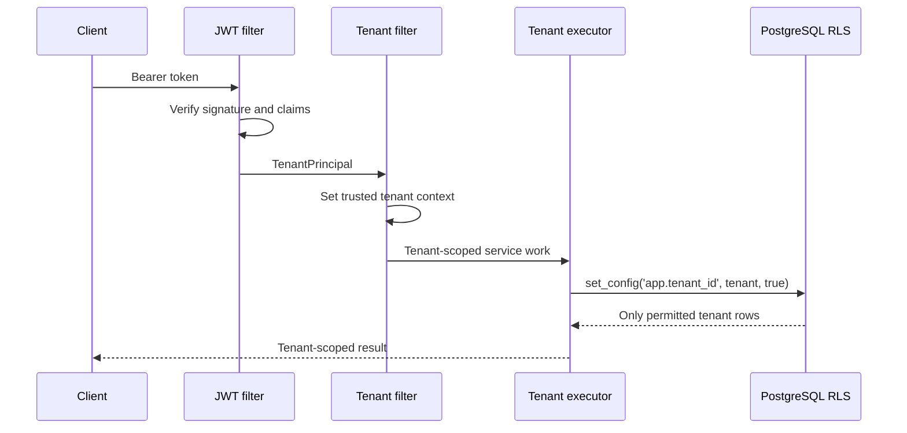

# Security Guide

## Security objective

Canopy protects tenant data by treating tenant identity as a verified security claim rather than a request parameter. The system applies defense in depth: signed-token validation, trusted request context, transaction-local PostgreSQL context, server-derived entity ownership, same-workspace relationship checks, and PostgreSQL row-level security.

## Authentication model

Protected backend routes require a bearer token. `JwtAuthFilter` verifies the token signature and creates a `TenantPrincipal` only after valid user and tenant claims are available. The principal supplies the user ID for activities such as event recording and diagnostic review.

| Environment | Authentication behavior |
|---|---|
| Local development Compose | A limited local demo-session endpoint may issue a token for seeded data when explicitly enabled. |
| Production Compose / Render + Vercel | Clerk Organizations issues signed session tokens. The frontend gateway forwards the token; the backend validates its RS256 signature, issuer, expiry, and `canopy-api` audience, then derives the user and tenant from signed `sub` and active-organization claims (`org_id` in Clerk token v1 or `o.id` in v2). `LOCAL_DEMO_AUTH_ENABLED=false`. |

> The demo-session endpoint exists only to make local developer workflows usable. It must remain disabled in public deployments and must not be repurposed into a production password or user-selection API.

In Clerk Dashboard, add custom claims under **Sessions → Customize session token**: `aud` set to `canopy-api`, `email` set to `{{user.primary_email_address}}`, and `org_name` set to `{{org.name}}`. Use the default session token so it retains session-bound claims. Clerk v1 places active organization claims at `org_id`/`org_role`; v2 places them in the `o` object at `id`/`rol`. The backend accepts both formats and rejects tokens without an active organization membership. Organization membership currently grants access to the tenant; fine-grained business-role authorization is not implemented yet.

## Tenant isolation flow

| Layer | Control | Why it matters |
|---|---|---|
| JWT filter | Validates token signature and claims | Prevents unauthenticated or forged identities. |
| Tenant filter | Derives tenant from the verified principal | Prevents a client from selecting a different workspace. |
| Identity provisioning | Atomic PostgreSQL ON CONFLICT within TenantAwareExecutor | Safely handles concurrent requests without duplicate key conflicts while enforcing RLS. |
| Header mismatch guard | Rejects conflicting caller tenant header | Detects or blocks legacy/client misuse. |
| Tenant executor | Requires tenant context and scopes PostgreSQL context to the transaction | Protects pooled-connection behavior. |
| Ownership listener | Writes `tenant_id` from trusted context | Prevents ownership injection through request JSON. |
| Domain services | Validate same-workspace relationships | Prevents cross-record reference abuse. |
| PostgreSQL RLS | Restricts visible rows to `app.tenant_id` | Retains enforcement at the data layer. |

## Database roles and row-level security

Production uses two PostgreSQL credentials. The owner role initializes schema and grants permissions. The backend receives the separate non-owner application role created by `database/04-create-app-role.sh`. This separation matters because a table owner can otherwise bypass ordinary RLS behavior.

The security-hardening script forces RLS on tenant-owned tables and sets `tenant_id` defaults from the transaction-local application setting. Fresh database initialization applies the script automatically. Existing databases require a reviewed migration process and backup before applying it.

| Role | Intended use | Must not be used for |
|---|---|---|
| Database owner | Schema initialization and controlled migrations | Backend runtime requests. |
| Application role | Backend runtime CRUD through RLS | Schema changes, superuser activity, or operator administration. |

## Authorization and record relationships

The current authorization model scopes all authenticated business operations to the active tenant. Services validate in-tenant relationships before persistence, including crop batch to zone, treatment to batch, diagnostic to batch, order line item to order, order line item to batch, and batch event to batch.

A `404` response for an absent record should not be interpreted as proof that a record exists in another workspace. The product must avoid cross-tenant existence disclosure in errors, logging, and user interface copy.

## Immutable operational history

Batch events are treated as immutable facts. PostgreSQL triggers reject event updates and deletion. If a field event is incorrect, the correction must be recorded as a compensating event rather than overwriting the original record. This supports auditability and future reliable offline synchronization.

## Browser and frontend controls

The frontend uses a same-origin API gateway and standard security headers, including a nonce-based strict Content-Security-Policy from Clerk middleware, content-type, framing, referrer, permissions, and opener protections. The API gateway returns a controlled `503` if it cannot reach the backend, rather than exposing low-level upstream errors.

Read caching may use browser IndexedDB. Cache entries are operational convenience data, not an authorization source: a browser session must still acquire valid authentication before a current API request is accepted.

## Secrets management

Production values are provided through `.env.production`, which is excluded from source control. The template `.env.production.example` identifies required configuration without containing secrets.

| Secret | Purpose | Handling requirement |
|---|---|---|
| `CLERK_SECRET_KEY` | Server-side Clerk SDK access for the frontend | Secret environment variable in Vercel; never use a `NEXT_PUBLIC_` prefix. |
| `CLERK_ISSUER`, `CLERK_JWKS_URL` | Validate Clerk tokens at the backend | Set from the Clerk production application; verify issuer and JWKS URL match the deployed environment. |
| `POSTGRES_PASSWORD` | Owner database credential | Unique, stored outside source control, limited to administration. |
| `APP_DB_PASSWORD` | Backend application database credential | Unique, stored outside source control, least privilege. |
| `CADDY_DOMAIN` | TLS routing domain | Must match DNS configuration; not secret but environment-specific. |

Rotate credentials through a controlled deployment process, update the runtime environment, and confirm service health before revoking the previous credential.

## Logging and privacy

Do not log bearer tokens, passwords, tenant-scoped payloads containing sensitive customer or crop details, or raw diagnostic images. Logs should provide request correlation, route, status, service health, and safe operational context without becoming a parallel data store.

Any future media upload feature must document storage location, object-level access controls, retention policy, malware scanning, and signed URL behavior before accepting production images.

## Validation status and remaining hardening work

Backend unit tests verify trusted tenant assignment and missing-context rejection. H2 does not implement PostgreSQL RLS, so it cannot prove database policy enforcement. `PostgresRlsIntegrationTest` exercises the actual PostgreSQL/TimescaleDB policy stack using the non-owner application role; the hosted `Production checks` workflow must pass it with zero skips before a public multi-tenant release.

Clerk integration is implemented, but a production Clerk application, token-template claim verification, and end-to-end tenant-isolation checks must be completed before real users are admitted. The PostgreSQL RLS integration test is implemented; its hosted CI result and live tenant-isolation smoke checks remain release prerequisites. Free Render Postgres is temporary and has no managed backups; it is unsuitable for durable production data.

## Security incident response

If a suspected tenant-isolation, token, or credential event occurs, disable affected user sessions at the identity provider, rotate implicated credentials, preserve relevant logs, and inspect database access through the owner role. Do not alter append-only batch events as part of incident triage. Restore service only after the scope, containment action, and corrective deployment are recorded.
